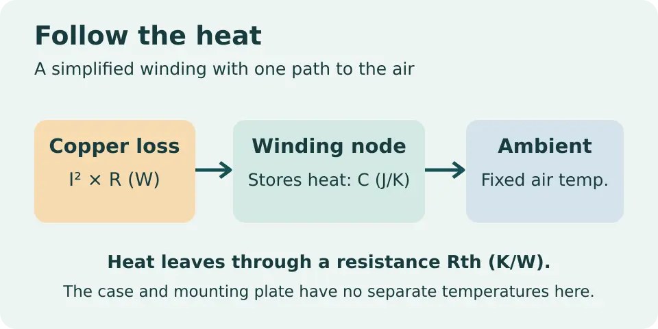
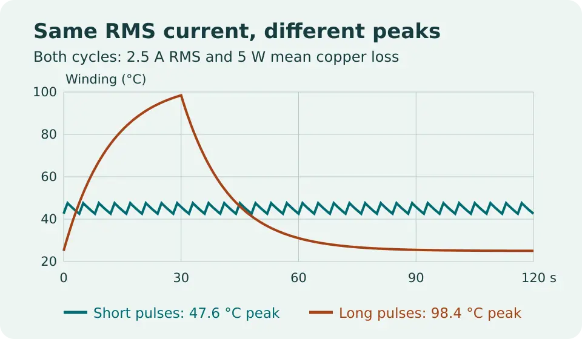

# Robot Motor Thermal Sizing Lab

Estimate winding temperature for a hypothetical brushed DC motor driven by a repeated current schedule. Two examples have the same RMS current and average copper loss, yet one produces a much hotter winding at the end of its pulse.

[Read the full WIFA Robotics lesson](https://wifarobotics.com/learn/robot-motor-thermal-sizing/).

## Start from zero

1. Install [Python 3.10 or newer](https://www.python.org/downloads/). Check it with `python3 --version` on Linux or macOS, or `py -3 --version` on Windows.
2. On GitHub choose **Code → Download ZIP**. Extract it, then open a terminal in the extracted folder. Run `ls` or `dir` and confirm you can see `thermal.py` and `examples`.
3. Run the commands below. On Windows, replace `python3` with `py -3`. No virtual environment, pip packages, motor or network connection is required after download.

```sh
python3 thermal.py examples/short-pulses.json
python3 thermal.py examples/long-pulses.json
python3 thermal.py examples/warm-enclosure.json
python3 -m unittest discover -s tests -v
```

| Example | Current schedule | RMS current | Peak from ambient | Repeating peak |
|---|---|---:|---:|---:|
| Short pulses | 5 A for 1 s, 0 A for 3 s at 25 °C | 2.500 A | 31.396 °C | 47.565 °C |
| Long pulses | 5 A for 30 s, 0 A for 90 s at 25 °C | 2.500 A | 98.433 °C | 98.437 °C |
| Warm enclosure | Same long cycle at 45 °C | 2.500 A | 118.433 °C | 118.437 °C |

## Make a new example

Copy one file in `examples/` and change its `steps`. Each step specifies signed winding `amps` and `seconds`. A reverse current heats the winding too. The other keys are `ambient_c` (°C), `resistance_ohm` (Ω), `thermal_k_per_w` (K/W) and `thermal_j_per_k` (J/K). The last two describe a single thermal node. Run your copy with `python3 thermal.py examples/my-cycle.json`.

Mean copper loss is winding resistance times RMS current squared. The cold peak includes only the first cycle starting at ambient. The repeating peak assumes the same schedule continues until each cycle starts at the same temperature. The two numbers can differ even when nothing changes in the current schedule.

## Troubleshooting

* **Cannot open file:** open the terminal in the extracted project directory. Paths are relative to where you run the command.
* **Invalid JSON:** use double quotes for keys, no comments, and no trailing commas. All physical inputs are JSON numbers; the duration of each step must be positive.
* **A negative current did not cool the model:** copper loss uses the square of winding current. A braking segment still contributes if current flows through the winding.
* **My housing thermometer disagrees:** housing temperature and winding temperature are different. This model has no housing node or sensor model.

## Diagrams and boundaries





Edit the diagram SVGs directly. `python3 diagrams/make_plot.py` regenerates the comparison SVG from the bundled examples. To rasterize, for example, run `inkscape diagrams/pulse-comparison.svg -o pulse-comparison.png` followed by `convert pulse-comparison.png -quality 87 diagrams/pulse-comparison.webp`.

This is an offline, single node model with constant resistance and fixed ambient. Its inputs are invented for teaching. It does not predict BLDC phase heating from DC bus current, account for speed dependent loss, model a hot spot or identify safe motor or drive limits. Do not use its output to set motor protection, disable current limits or plan a powered overload test. Follow the actual motor and drive documentation for current conventions, temperature limits and mounting conditions.

Primary references: [maxon winding protection](https://support.maxongroup.com/hc/en-us/articles/4412763373970-maxon-controllers-I2t-Limitation-Motor-winding-protection), [COMSOL lumped thermal capacitance theory](https://doc.comsol.com/6.3/doc/com.comsol.help.heat/heat_ug_theory.07.039.html), [MathWorks thermal mass and motor thermal circuit](https://www.mathworks.com/help/simscape/ref/thermalmass.html).
